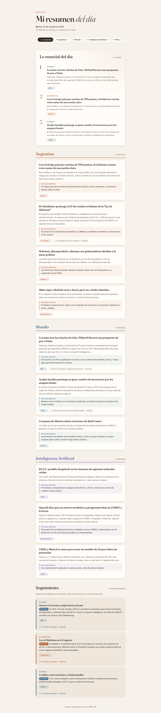

# Mi resumen del día

Un sitio estático y personal para leer las noticias esenciales del día, agrupadas por tema (Argentina, Mundo, Inteligencia Artificial). Sin frameworks ni paso de build: HTML, CSS y JavaScript plano.



## Estructura

```
index.html     Estructura de la página
styles.css     Estilos (incluye modo oscuro automático)
app.js         Genera el contenido a partir de los datos
noticias.js    Los datos: las noticias del día
hilos.js       Historial persistente de hilos (historias en el tiempo)
docs/          Capturas de pantalla para este README
```

## Cómo actualizar las noticias

Editá `noticias.js`:

```js
window.NOTICIAS = {
  "fecha": "2026-10-20",       // AAAA-MM-DD
  "ejemplo": false,             // true muestra el aviso "Datos de ejemplo"

  // Opcional: las 3 noticias más importantes, arriba de todo ("Lo esencial del día")
  "esencial": [
    { "titulo": "...", "resumen": "...", "tema": "Mundo", "fuente": "BBC", "url": "https://..." }
  ],

  "temas": [
    { "nombre": "Argentina",
      "noticias": [
        { "titulo": "...", "resumen": "1-2 oraciones.",
          "porQueImporta": "Opcional: una oración sobre por qué importa o qué sigue.",
          "fuente": "Nombre del medio", "url": "https://...",
          "hilo": "guerra-ucrania" }   // opcional: id del hilo al que pertenece
      ] }
  ],

  // Opcional: hilos que tuvieron novedades hoy y que ya existían antes
  "seguimiento": [
    { "hilo": "guerra-ucrania", "novedad": "Qué cambió desde la última entrada.", "fuente": "BBC", "url": "https://..." }
  ]
};
```

Todos los campos nuevos son opcionales: si faltan, esa parte simplemente no se muestra. El campo `tema` de `esencial` y `seguimiento` debe coincidir con el `nombre` de un tema para tomar su color.

Podés agregar o quitar temas; el menú y los contadores se generan solos. Se usa un archivo `.js` (no `.json`) para que `index.html` funcione también abierto directamente desde el disco.

## Hilos (historias que se siguen en el tiempo)

`hilos.js` guarda el historial completo de cada historia en curso. **Crece cada día y nunca se reinicia.**

```js
window.HILOS = {
  "guerra-ucrania": {
    "nombre": "Guerra en Ucrania y negociaciones de paz",
    "tema": "Mundo",                 // debe coincidir con un tema para tomar su color
    "creado": "2026-10-20",
    "actualizado": "2026-10-20",     // fecha de la entrada más reciente
    "entradas": [                    // la más nueva primero
      { "fecha": "2026-10-20", "titulo": "...", "resumen": "...", "fuente": "BBC", "url": "https://..." }
    ]
  }
};
```

En la página, cada noticia con `hilo` muestra un chip (`↳ Nombre del hilo · N entradas`) que lleva a la sección **Seguimiento**, donde cada hilo tiene su línea de tiempo desplegable. Los hilos de `seguimiento` muestran "Última novedad anterior: hace N días" (si hay una entrada previa) y la novedad; los demás aparecen en "Otros hilos".

**Archivo automático:** un hilo cuyo `actualizado` tiene más de 30 días respecto de `fecha` (en `noticias.js`) pasa solo al bloque plegado "Archivo de hilos" al final de Seguimiento. Se calcula con las fechas; no hay que tocar los datos. Si un hilo archivado recibe una entrada nueva, vuelve a estar activo. El contador del menú cuenta solo los hilos activos.

### Procedimiento diario (actualización de las 7:00)

1. Para cada noticia nueva, revisá **todos** los hilos de `hilos.js`, incluidos los viejos, inactivos y **archivados** (más de 30 días sin novedades), comparando id, `nombre` y contenido de las entradas.
2. Si la noticia continúa una historia existente, **reutilizá ese id** en `hilo` (aunque no haya tenido novedades en días o semanas).
3. Si no existe y la historia probablemente siga en los próximos días, creá un hilo nuevo con un id estable en kebab-case (ej. `ley-malvinas`), `creado` = hoy. Las noticias puntuales no llevan `hilo`.
4. Agregá la entrada del día **al principio** de `entradas` y actualizá `actualizado`.
5. En `noticias.js`, `seguimiento` lista solo los hilos que tuvieron novedad hoy **y** ya existían antes de hoy, con `novedad` = qué cambió desde la entrada anterior.
6. Nunca borres entradas ni hilos.

## Ver en local

Abrí `index.html` en el navegador, o levantá un servidor:

```
python3 -m http.server 8000
```

y entrá a http://localhost:8000

## Publicar en Vercel

1. Subí este repositorio a GitHub.
2. En Vercel: **Add New → Project** e importá el repo.
3. Framework Preset: **Other**. Build Command: vacío. Output Directory: vacío (raíz del repo).
4. **Deploy**. Cada `git push` a `main` vuelve a publicar el sitio.
